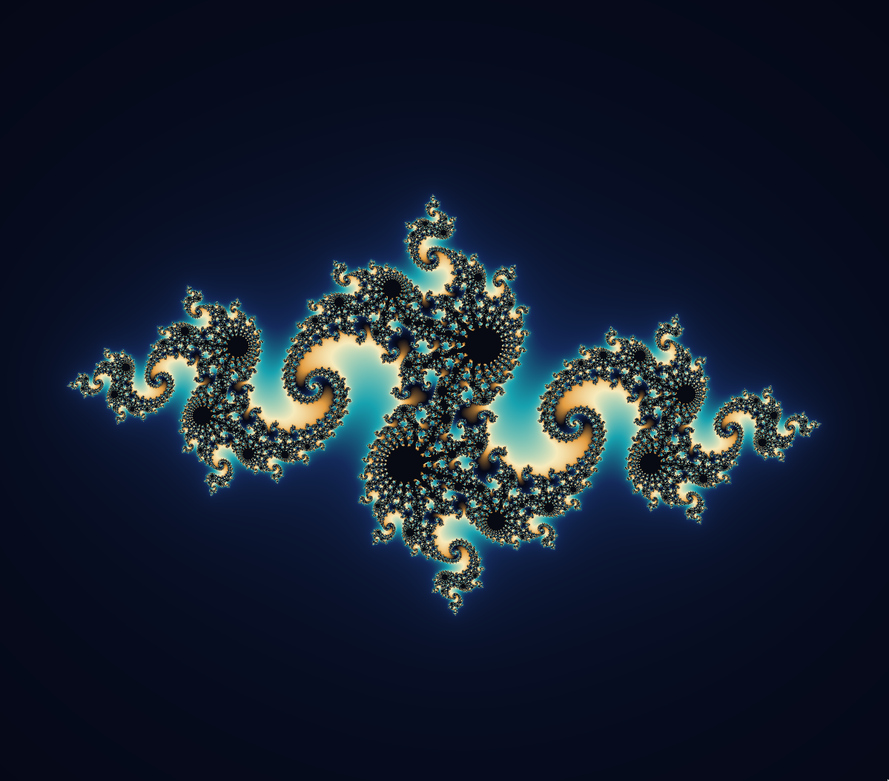
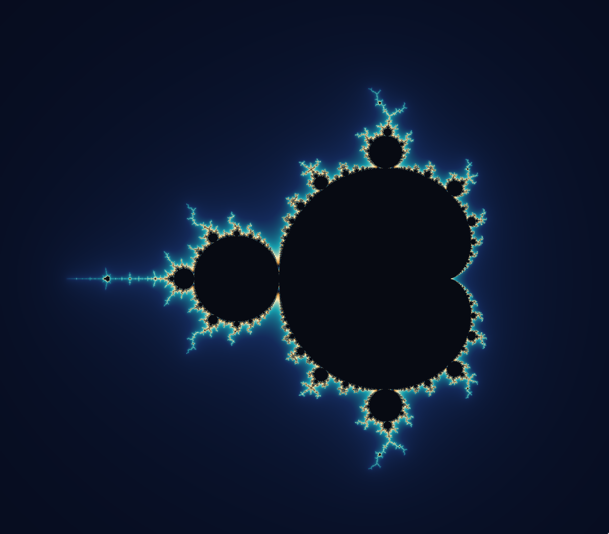
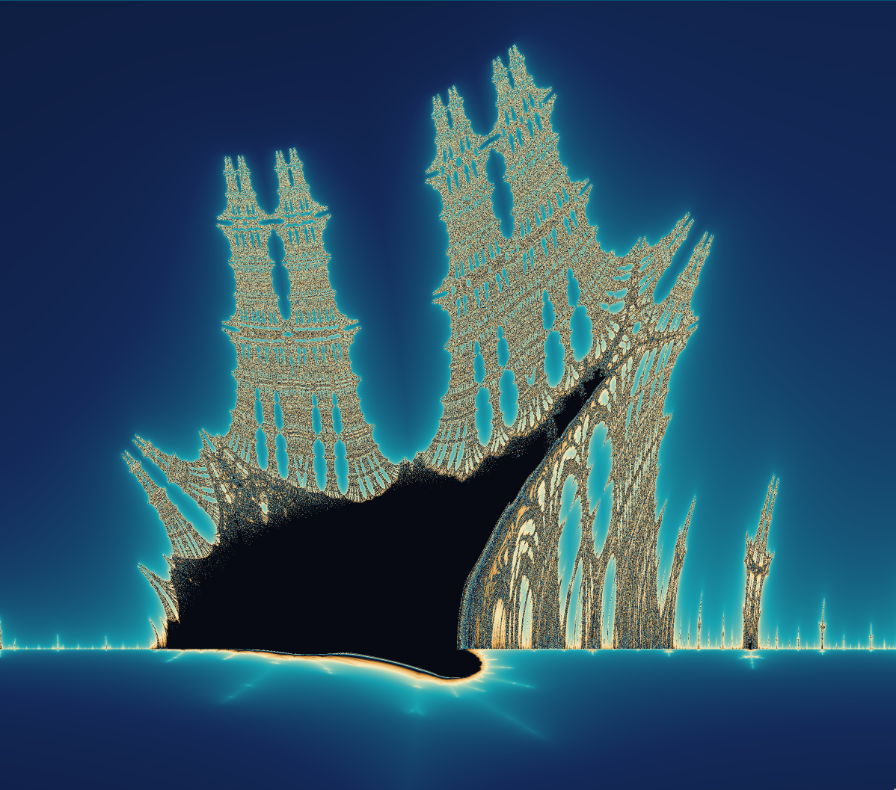

# Fractaler

Rendering beautiful fractals (**Julia**, **Mandelbrot** and **Burning Ship**) in C [zoom, pan, color controls].

<table>
  <tr>
    <td align="center" width="33%"><br>Julia</td>
    <td align="center" width="33%"><br>Mandelbrot</td>
    <td align="center" width="33%"><br>Burning Ship</td>
  </tr>
</table>

## Usage

```sh
make
./fractol M
./fractol J
./fractol J -0.8 0.156
./fractol B
```

## Libraries

- [MiniLibX](https://github.com/42paris/minilibx-linux) (Linux/X11)
