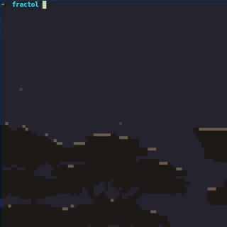

# Fractaler

Rendering beautiful fractals (**Julia**, **Mandelbrot** and **Burning Ship**) in C [zoom, pan, color controls].

<table>
  <tr>
    <td align="center" width="33%"><br>Julia</td>
    <td align="center" width="33%"><br>Mandelbrot</td>
    <td align="center" width="33%"><br>Burning Ship</td>
  </tr>
</table>

<div align="center">
  
  <br>
  Julia and Mandelbrot infinite zoom demo. <a href="images">Check images</a>
</div>

## Usage

```sh
gcl https://github.com/0xseljarida/fractaler.git && cd fractaler # clone and enter
make # compile
./fractol M
```

Run `./fractol` for usage details.

## Libraries

- [MiniLibX](https://github.com/42paris/minilibx-linux) (Linux/X11)
